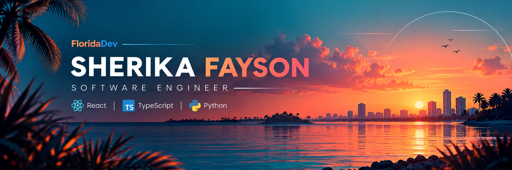
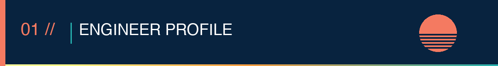
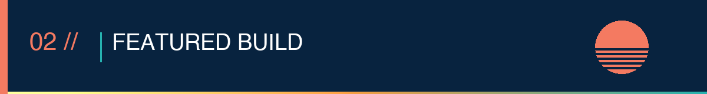
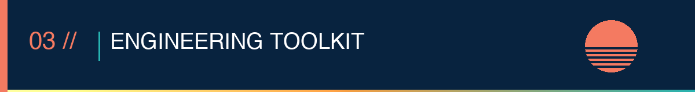
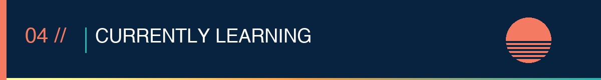
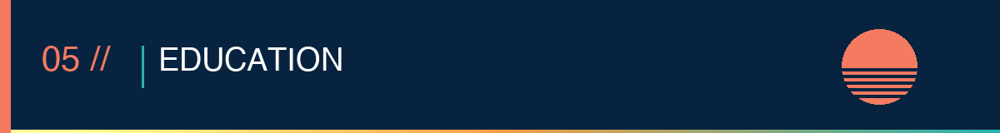

  

  

  <strong>Full-Stack Engineer</strong> | React · TypeScript · Python
    
  I ship production web apps end to end. As a U.S. Marine Corps avionics technician I diagnosed complex systems under pressure, and I bring that discipline to debugging and delivery.
    
  📍 Orlando, FL · 🟢 Open to Software Engineering roles

  

  

### ResourceHub

*Community Resource & Budgeting Android App*

*Solo-built Android prototype in five weeks*

<table>
  <tr>
    <td width="50%"><strong>Problem</strong> People seeking essential services often have to search across multiple sources for housing, food, jobs, and utility assistance.</td>
    <td width="50%"><strong>Built</strong> A mobile app for searching community resources with category filters, favorites, and personal budget tracking.</td>
  </tr>
  <tr>
    <td width="50%"><strong>Architecture</strong> Kotlin → Android → XML</td>
    <td width="50%"><strong>Engineering</strong> ZIP code search · SharedPreferences · Local persistence</td>
  </tr>
</table>

  

| **Layer** | **Tools** |
| ---------- | --------- |
| **Frontend** | React, TypeScript, JavaScript |
| **Backend** | Python, FastAPI, REST APIs |
| **Data** | PostgreSQL, SQL |
| **DevOps** | Git, Docker, Linux, CI/CD |

  

- Python & Object-Oriented Programming
- Data Structures & Algorithms
- System Design

  

**Bachelor of Science in Information Technology**  
Software Development & Coding  
ECPI University | April 2027

**Associate of Science in Computer & Information Science**  
Software Development  
ECPI University | 2025